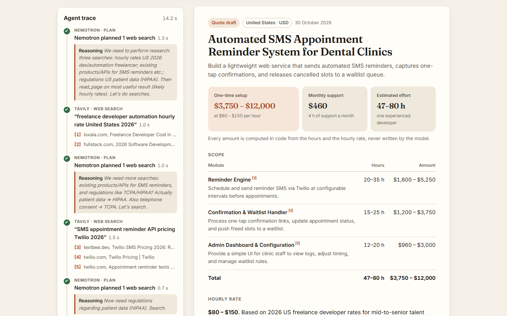
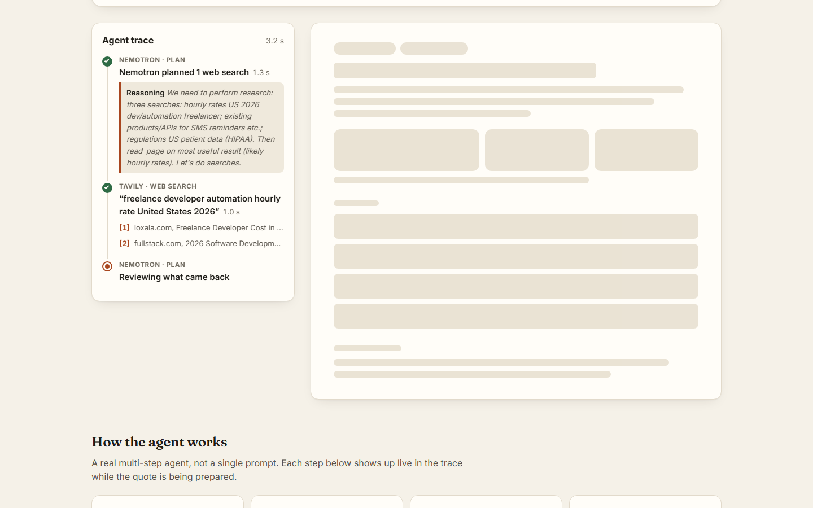
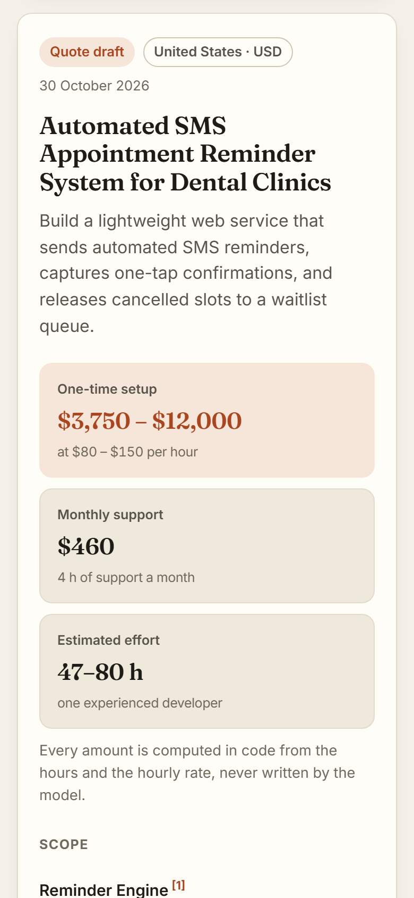
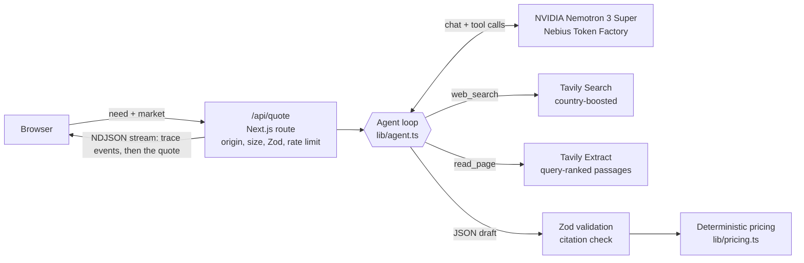
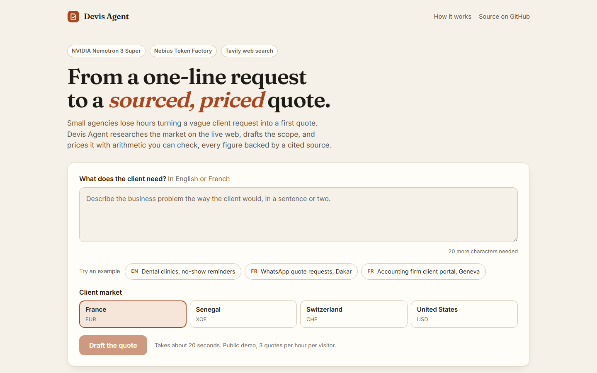
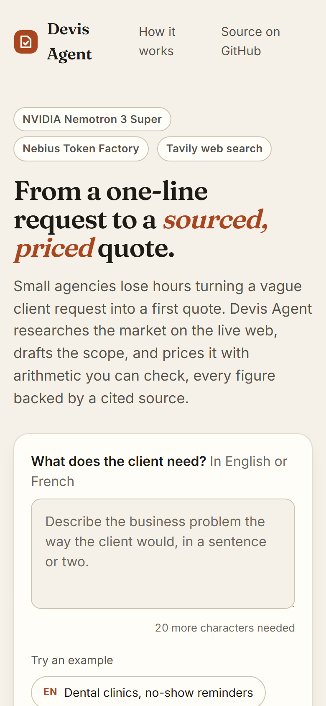
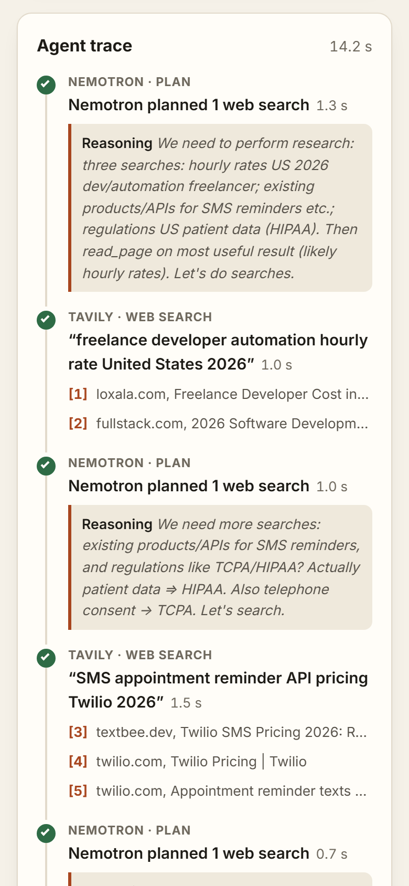

# Devis Agent

**From a one-line client request to a sourced, priced quote draft.** An agent that researches the market on the live web with Tavily, drafts the scope with NVIDIA Nemotron 3 Super on Nebius Token Factory, and prices it with arithmetic you can check.

Built for the Nebius x NVIDIA Global AI Hackathon, Best Apps and Agents track.

- Live demo: **https://devis-agent-nebius.vercel.app** (no sign-up, three one-click examples)
- Demo video and submission: on the Devpost project page
- License: MIT
- Built from scratch for this hackathon, during the submission period: the repository and its first commit date from 30 October 2026.



## The problem

Small web and automation agencies get the same kind of message every week: one or two sentences describing a business problem. *"Patients book by phone and no-shows are costing us chair time."* Before anyone can reply with a number, someone has to work out the modules, estimate the hours, check what freelancers charge in that country this year, find which API the build would sit on and what it costs, and remember which data protection rules apply. That research is the slow part, and it is exactly what a generic chatbot skips: it will happily invent a rate and a total.

Devis Agent does that first pass the way a careful consultant would. It looks things up first, cites what it found, and never lets the language model do the arithmetic.

## What it does

1. Describe the need in English or French, or click one of the three examples.
2. Pick the client's market: France (EUR), Senegal (XOF), Switzerland (CHF) or the United States (USD).
3. Watch the agent work in a live trace: Nemotron plans, Tavily searches, Nemotron picks the best source, Tavily Extract reads it, Nemotron drafts, the code checks and prices.
4. Get a quote draft in about 15 to 20 seconds: modules with hour ranges, a one-time setup range, monthly support, the hourly rate and its rationale, tools and integrations, compliance points, assumptions, questions for the client, and numbered sources. Every claim that rests on the web carries a citation.
5. Copy it as Markdown, download a `.md` file, or print it to a clean PDF.

The quote is written in the language of the request, priced in the currency of the market, and clearly labelled as a draft for a consultant to review before it reaches a client.

| Live trace while the agent works | Mobile |
| --- | --- |
|  |  |

## How it works



**Research.** Nemotron receives two tools in the OpenAI function-calling format. `web_search` runs a Tavily search boosted toward the client's country. `read_page` reads one page that a search returned, through Tavily Extract. The prompt asks for one search per topic (market rates, the products or APIs the build relies on, the regulation that applies to the data involved), then one full read of the most useful source. The loop is bounded: at most 3 searches, 1 page read, 4 planning rounds and 25 seconds of research. `read_page` only unlocks after two searches have come back, and it only accepts a URL that a search actually returned, so the model cannot send the extractor anywhere it likes.

**Drafting.** Nemotron writes the quote with `response_format: json_schema` in strict mode, from a schema generated by Zod (`z.toJSONSchema`). The response is parsed and validated again with the same Zod schema. If it fails, the validation errors go back to the model for one repair attempt. If that fails too, the user gets a clean error, never a half-rendered quote.

**Checking and pricing.** The model only proposes hour ranges per module and an hourly rate band. The code does the rest: it lifts the inline citation marks Nemotron sometimes adds to its prose (`【3†twilio.com】`) into the line's citation list, keeps only citations that point to a source the agent retrieved, brings the rate back inside a wide per-market guard band (catching a rate in the wrong currency or a missing zero), multiplies hours by rate, and rounds totals per market. The model is told never to write an amount, and no line amount or total on screen comes from it.

**Streaming.** The route streams newline-delimited JSON events. The browser upserts each trace step as it changes state (running, done, failed, skipped), then renders the quote when the final event arrives.

## How it uses Nebius Token Factory and NVIDIA Nemotron

- **Endpoint.** `https://api.tokenfactory.us-central1.nebius.com/v1/chat/completions`, called with `fetch` in [`lib/nebius.ts`](lib/nebius.ts). No SDK needed, the API is OpenAI-compatible.
- **Model.** `nvidia/nemotron-3-super-120b-a12b`, overridable with `NEBIUS_MODEL`.
- **Tool calling.** The agent loop relies on Nemotron's native function calling to decide what to search and which page to read. In our runs Nemotron issues one tool call per turn, so the loop is built around rounds rather than assuming parallel calls.
- **Reasoning, visible.** Every call passes `chat_template_kwargs: { enable_thinking: true, low_effort: true }`. Nemotron keeps a short thought before each answer, which the trace shows under each planning and drafting step, without paying for a full reasoning pass.
- **Structured output.** The draft uses `response_format` with a strict JSON schema, then Zod validation on top.
- **Budgets.** 500 output tokens per research turn, 2,200 for the draft, 30 seconds per call. A typical quote takes 5 Nemotron calls and about 11,000 tokens.

**Where Token Factory accelerated the work.** One OpenAI-compatible endpoint carried every capability the agent needs: tool calling for the research loop, strict `json_schema` output for the draft, and `chat_template_kwargs` for the reasoning switch. No SDK, no model to host, no GPU to provision: the whole integration is [`lib/nebius.ts`](lib/nebius.ts), under 100 lines, which left the time for the guard rails around the model. At run time, low-effort thinking keeps each research turn around one second (0.7 to 1.3 s in the run shown above), so five Nemotron calls fit in a quote that is ready in about 15 seconds.

**Other Nebius services.** None. The app only needs hosted inference, which Token Factory provides; the Next.js front end and its streaming route run on Vercel. Nebius AI Cloud, Serverless Endpoints and Serverless Jobs are not used.

## How it uses Tavily

Tavily is the agent's only window on the outside world, and it is called at runtime on every quote.

- **Search** ([`lib/tavily.ts`](lib/tavily.ts)): `POST /search` with `country` set from the chosen market (`france`, `senegal`, `switzerland`, `united states`), `search_depth: basic`, 4 results, an 8 second timeout. Results are validated with Zod, deduplicated by URL across searches and numbered, so the model can cite `[3]` and the code can check that `[3]` exists.
- **Extract**: `POST /extract` on the source Nemotron chose, with `query` set to what the model is looking for and `chunks_per_source: 3`, so the model receives the passages that answer its question (the rate table, the pricing grid) instead of a whole page. 10 second timeout. The source then carries a "read in full" badge in the quote.
- **Untrusted by design.** Search results and page passages are passed to the model as data. The system prompt tells it never to follow instructions found inside them, and citations are verified in code.
- **Graceful degradation.** A failed search or extract shows as a failed step in the trace and the agent carries on. Without a Tavily key the agent drafts from the model alone and the quote is flagged as not checked against current market data.

## Security and cost controls

- API keys live only in server-side environment variables. The browser only ever talks to `/api/quote`, and the Content Security Policy restricts `connect-src` to the same origin.
- `/api/quote` requires a same-origin `Origin` header and a JSON body under 4 KB, validates it with Zod (20 to 1,000 characters, a known market), then applies two caps: 3 quotes per hour per IP and 40 per day in total. The limiter is in memory per instance, a deliberate choice explained in [`lib/ratelimit.ts`](lib/ratelimit.ts).
- Every external call is bounded: output tokens, timeouts, number of tool calls and total research time.
- Security headers on every route: CSP, HSTS, `X-Frame-Options: DENY`, `nosniff`, a strict `Referrer-Policy` and `Permissions-Policy`.

## Trying it as a judge

- **Online.** Open the live demo, click an example, then "Draft the quote". No account, no key. To protect the paid API keys behind it, the demo allows 3 quotes per hour per visitor and 40 per day in total; the limit message says so if you reach it.
- **Locally, with your own keys.** Follow the steps below; the caps then apply to your own instance only.
- **Without any key.** `npm install && npm test` runs the agent loop end to end against scripted model and search responses: tool budgets, a failed search, a refused extract URL, citation filtering, the rate guard band and the repair round.

## Run it locally

Requires Node 20 or later, a [Nebius Token Factory](https://tokenfactory.nebius.com) API key and a [Tavily](https://app.tavily.com) API key.

```bash
npm install
cp .env.example .env.local   # then set NEBIUS_API_KEY and TAVILY_API_KEY
npm run dev                  # http://localhost:3000
```

Checks:

```bash
npm run typecheck
npm run lint
npm test                     # agent loop, tool budgets, citation and pricing rules, language detection, no key needed
npm run build
```

One real generation from the command line, printing the trace as it streams (costs one quote):

```bash
npx tsx scripts/smoke.mts france "We run two dental clinics and no-shows are costing us chair time..."
```

## Project structure

```
app/
  page.tsx              Landing page and "how it works"
  QuoteWorkbench.tsx    Form, examples, market picker, stream reader
  AgentTrace.tsx        Live trace of the agent's steps
  QuoteDocument.tsx     The quote, Markdown export, print
  QuoteSkeleton.tsx     Loading state shaped like the quote
  api/quote/route.ts    Guards, then streams the agent's events
  opengraph-image.tsx   Social card
lib/
  agent.ts              Research loop, drafting, repair, checks
  nebius.ts             Token Factory client, Zod-validated responses
  tavily.ts             Tavily Search and Extract clients
  pricing.ts            Citation filtering and deterministic pricing
  markets.ts            Currencies, locales, guard bands
  quoteSchema.ts        Zod schemas and shared types
  language.ts           Picks the quote language from the request
  markdown.ts           Markdown export
  ratelimit.ts          Per-IP and daily caps
tests/                  node:test suites, run with tsx
scripts/smoke.mts       One real end-to-end generation
```

## Screenshots

All taken on the production deployment on 30 October 2026, with a real generation.

| Landing, desktop | Landing, mobile | Trace, mobile |
| --- | --- | --- |
|  |  |  |

The complete quote, top to bottom: [docs/screenshots/desktop-quote-full.png](docs/screenshots/desktop-quote-full.png).

## License

[MIT](LICENSE)
